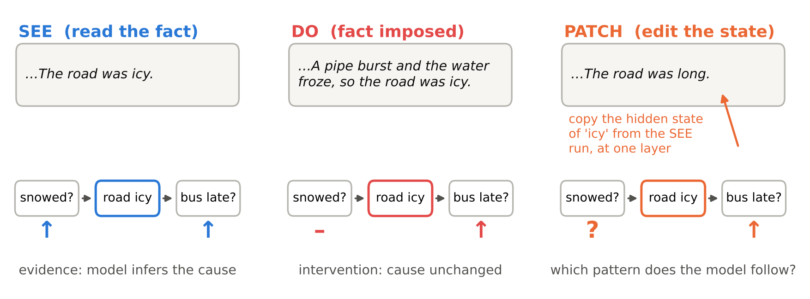
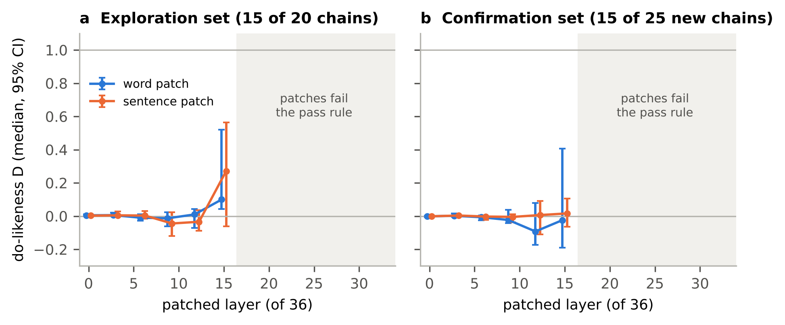

# Doing or Seeing? Activation patching makes language models infer the cause of the patched fact

**Pranav Kalla, Pranav Prabhakar**. This was our Advanced Data Analytics (Jackfruit) project at PES University, Bengaluru.

Researchers edit LLM hidden states (activation patching) and call it a causal intervention, Pearl's *do()*. We test whether the model agrees.

We used 79 causal scenarios (1,896 stories), three structures (chains, colliders, forks), three model families (Qwen3-4B, Llama-3.2-3B, Gemma-2-2B) and two answer formats. Across all of them, a **patched fact is treated as evidence**. The model infers the fact's usual cause and explains away rival causes, exactly as when it reads the fact; the do-likeness score is **D ≈ 0** wherever patches work.

A second, pre-registered finding concerns where the knowledge that a fact was *imposed* is held. It sits at the **cause words**, and reaches the fact's own position only late in the network and only partly.

📄 [Paper](paper/Kalla_Prabhakar_ActivationPatching_SeeingVsDoing.pdf) ([earlier course version](paper/v1_course_report/GroundTruth_IEEE_Report_v1.pdf)) · 📊 [Slides](slides/GroundTruth_Jackfruit_Final.pdf) · 🗂 [Dataset card](data/README.md)



## Results at a glance

| Result | Number |
|---|---|
| Patched chains, Qwen (25 held-out chains) | median D −0.09 … +0.01, true patch beats unrelated in 100% of scenarios |
| Colliders: explaining away after a patched fact | 0.92–1.21 log-odds (vs 1.10 when the fact is read; 0 for a true intervention) |
| Replication | Llama −0.03 … +0.01, Gemma −0.01 … +0.08, True/False format −0.05 … +0.01 |
| Do-source patch (pre-registered, fresh items) | = see-source early; +0.12 … +0.30 (Qwen), +0.34 … +0.54 (Llama) late; 4/5 predictions held in full |
| Steering (first attempt) | looked like seeing but was a yes-bias: cause +2.62 vs unrelated questions +3.04 |



## Repository layout

| Folder | Contents |
|---|---|
| `notebooks/` | Notebook `00_results_and_figures.ipynb` runs on CPU and rebuilds every figure and table from `results/`. Notebooks `01`–`17` are the GPU experiments; `archive/` holds superseded versions. |
| `data/`, `data_generators/` | The dataset (with its data card) and the deterministic scripts that generate it. |
| `results/` | Every CSV each experiment wrote. |
| `figures/`, `figures_code/` | The paper figures (PNG + PDF) and the scripts that make them. |
| `pre_registrations/` | Predictions written down before each confirmatory run. |
| `paper/`, `slides/` | The current paper (PDF), the earlier course report in `paper/v1_course_report/` (PDF + LaTeX), the one-pager and the slides. |

## Quick start

```bash
pip install -r requirements.txt
jupyter nbconvert --execute --to notebook --inplace notebooks/00_results_and_figures.ipynb
```

## Notebooks (run order)

| # | Notebook | What it tests | Platform | Results folder (`results/`) |
|---|---|---|---|---|
| 01 | `01_pilot_see_vs_do` | Which small model separates seeing from doing in text? (Pythia-1.4B, Gemma-2-2B, Qwen2.5-1.5B/3B, Qwen3-4B) | Colab T4 | — |
| 02–04 | `02/03/04_steering_*` | First attempt: steering vectors. Found a yes-bias artifact. | Colab T4 | `main_qwen/` (A_, B_, C_, D_ files) |
| 05 | `05_patching_exploration_qwen` | Main method: activation patching on 20 exploration chains. | Colab T4 | `main_qwen/P_exploration_*` |
| 06 | `06_patching_confirmation_qwen` | Same analysis on 25 new chains, pre-registered. | Colab T4 | `main_qwen/P_confirmation_*` |
| 07 | `07_H2_cause_projection_qwen` | H2: remove the cause direction from the patch. | Colab T4 | `main_qwen/H2_*` |
| 08 | `08_H3_colliders_qwen` | H3: colliders and explaining away. | Colab T4 | `main_qwen/H3_*` |
| 09–10 | `09_replication_llama`, `10_replication_gemma` | Replication on Llama-3.2-3B and Gemma-2-2B. | Kaggle 2×T4 | `llama/`, `gemma/` |
| 11–12 | `11/12_do_source_*` | Can a patch carry an intervention? Copy the fact from the **do** story. | Kaggle | `ds_qwen/`, `ds_llama/` |
| 13–14 | `13/14_forks_*` | Fork structures. | Kaggle | `fork_qwen/`, `fork_llama/` |
| 15 | `15_true_false_format_qwen` | Robustness: True/False answers instead of Yes/No. | Kaggle | `tf_qwen/` |
| 16–17 | `16/17_DS2_preregistered_*` | Pre-registered test of the late "intervention" signal on fresh variants, plus column and reverse patches. | Kaggle | `ds2_qwen/`, `ds2_llama/` |

## Running the GPU notebooks

1. **Kaggle (notebooks 09–17).**
   - Settings: Accelerator *GPU T4 x2*, Internet *on*.
   - Add a Kaggle secret named `HF_TOKEN`, holding a Hugging Face read token. Llama and Gemma are gated, so first accept their licences on Hugging Face.
   - Run with *Save & Run All*.
   - The data is embedded in the notebook, so nothing needs uploading.
   - Outputs appear as a zip under *Output*.
   - Runtime: about 1–4 h each; DS2 Qwen took about 3 h.
2. **Colab (notebooks 01–08).**
   - Use a T4 GPU.
   - The notebooks read the CSVs from `My Drive/jackfruit/` and write to `My Drive/jackfruit/results/`.
3. **Precision.**
   - Qwen and Llama use fp16 weights with an fp32 output layer.
   - Gemma uses bf16 with eager attention and logit soft-cap 30.

## Key definitions (as in the code)

- **Belief:** `b = log P(" Yes") − log P(" No")` after a 2-shot prompt. The True/False run uses " True"/" False" instead.
- **Filler correction:** subtract the mean shift on 3 unrelated questions from every shift.
- **Ratio:** `r = Δcause / Δeffect`. Forks use `Δcause / Δmediator`, and colliders use `ΔB / ΔC`.
- **Do-likeness:** `D = (r_see − r_edit) / (r_see − r_do)`. 0 means seeing and 1 means doing.
  - D is scored only where the edit moves the effect by at least ½ Δeffect(see).
- **Pass rule for a patch setting** (fixed before any confirmatory run):
  - fact shift ≥ 1;
  - true patch beats the unrelated patch by > 0.5, in ≥ 70% of scenarios;
  - |filler| < 0.5;
  - false patch < 0.
- **Statistics:** medians over scenarios with 95% bootstrap CIs (resampling scenarios). Comparisons between two sources use paired differences, plus a sign-flip test.

## Requirements

- **GPU notebooks:** `torch`, `transformers>=4.44`, `pandas`, `numpy`, `matplotlib`, `huggingface_hub`. These are preinstalled on Kaggle and Colab.
- **Notebook 00:** only `pandas`, `numpy` and `matplotlib`.

## Citation

```
@misc{kalla2026doingseeing,
  title  = {When We Edit an AI's Thoughts, Is It Doing or Seeing? Activation Patching Makes Language Models Infer the Cause of the Patched Fact},
  author = {Kalla, Pranav and Prabhakar, Pranav},
  year   = {2026},
  note   = {Advanced Data Analytics course project, PES University},
  url    = {https://github.com/PRANAVKALLA230106/see-vs-do}
}
```
